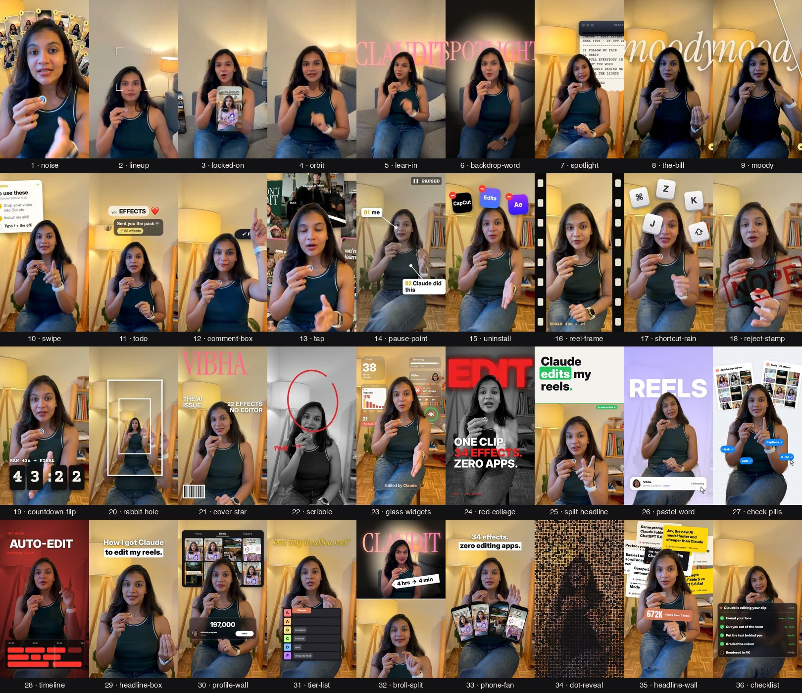

# 클로드 코드 /effects 한글판 – 영상 효과 45종

> 원작: [@vibha.in.progress](https://instagram.com/vibha.in.progress) 님의 [claude-video-effects](https://github.com/Vibha-Ramprakash/claude-video-effects) (MIT 라이선스) 💛
> 한글 번역·각색: 인디힌터 [@31brand](https://instagram.com/31brand)

## 소개
말하는 영상을 클로드 코드에 넣고 `/effects 효과이름`만 입력하면 편집 끝이에요. 편집 앱도, 타임라인도 필요 없어요. 효과는 얼굴을 따라다니고, 얼굴을 가릴 것 같으면 알아서 머리 뒤로 들어가요.



## 설치 (한 줄)
터미널(또는 클로드 코드 안 터미널)에 붙여넣으세요.

```bash
git clone https://github.com/haesam/claude-video-effects-ko ~/.claude/skills/effects
```

윈도우(PowerShell)는 `~/.claude/skills/effects` 대신 `$HOME\.claude\skills\effects`를 쓰세요. 그다음 클로드 코드를 재시작하면 끝이에요.

> 잘 모르겠다면 클로드 코드에 이렇게 붙여넣으세요: **"github.com/haesam/claude-video-effects-ko 스킬을 ~/.claude/skills/effects 에 설치해줘"**

이미 원작을 설치했다면 `~/.claude/skills/effects` 폴더를 지우거나 다른 이름으로 바꾼 뒤 설치하세요.

## 사용법
1. 클로드 코드를 열어요(앱 또는 터미널).
2. 영상을 채팅창에 끌어다 놓아요.
3. 원하는 효과를 입력해요.

```
/effects glass-widgets 처음 3초 동안
/effects orbit 3초부터 6초까지
/effects spotlight "불 꺼" 라고 말할 때, 뒤에 CLAUDE 글자
/effects comment-box 마지막에 CLAUDE 입력
```

처음 한 번은 자동 설정(약 2분)을 해요. `ffmpeg`와 파이썬이 필요하고, 없으면 클로드가 설치해줘요. 클로드가 몇 장면을 먼저 확인해 얼굴을 가리는 부분을 고친 뒤, 원본 옆에 `영상이름_effects.mp4`를 만들어줘요. 원래 소리는 그대로예요.

여러 효과를 한 번에 쌓을 수도 있어요: *"6~10초 locked-on, 10~13초 orbit, '아니요'에서 reject-stamp 넣어줘"*

## 효과 45종
| # | 입력할 이름 | 효과 |
|---|---|---|
| 1 | `noise` | 얼굴 뒤로 릴스가 0.25초마다 하나씩 쌓여요 |
| 2 | `lineup` | 번호 붙은 타일이 머리 위로 부채꼴처럼 펼쳐져요 |
| 3 | `locked-on` | 모서리 브래킷이 얼굴에 착 붙고 카메라가 따라와요 |
| 4 | `orbit` | 내 릴스들이 머리 주위를 돌아요(아래는 앞, 위는 뒤) |
| 5 | `lean-in` | 한 단어에서 빠르게 확 줌인돼요 |
| 6 | `backdrop-word` | 거대한 단어가 내 뒤로 떨어져요 |
| 7 | `spotlight` | 조명이 꺼지고 나만 밝게 남아요 |
| 8 | `the-bill` | 지시 사항이 영수증처럼 머리 위 벽에 출력돼요 |
| 9 | `moody` | 무드 있는 색보정 |
| 10 | `swipe` | 비포/애프터 슬라이더가 화면을 가로질러요 |
| 11 | `todo` | 말하는 동안 머리 옆 체크리스트가 하나씩 체크돼요 |
| 12 | `comment-box` | 인스타 댓글창에 단어가 입력되고 게시돼요 |
| 13 | `tap` | 팔로우 버튼이 떠서 팔로잉으로 바뀌어요 |
| 14 | `pause-point` | 화면을 멈추고 손글씨 화살표로 나를 가리켜요 |
| 15 | `uninstall` | 글리치 '삭제 중' 바가 화면을 깨뜨려요 |
| 16 | `reel-frame` | 영상이 인스타 릴스 카드 안으로 작아져요 |
| 17 | `shortcut-rain` | 키보드 키가 내 뒤로 비처럼 쏟아져요 |
| 18 | `reject-stamp` | 큰 빨간 도장이 화면에 쾅 찍혀요 |
| 19 | `countdown-flip` | 머리 위에 3, 2, 1 플립 시계 |
| 20 | `rabbit-hole` | 화면이 회전하며 안쪽으로 빨려 들어가요 |
| 21 | `cover-star` | 내가 잡지 표지가 되고 제목이 머리 뒤에 깔려요 |
| 22 | `scribble` | 마커 낙서가 내 주변에 저절로 그려져요 |
| 23 | `glass-widgets` | 반투명 유리 위젯과 미니 아이템이 머리 주위에 떠다니고 'Edited by Claude' 배지가 붙어요 |
| 24 | `red-collage` | 흑백의 나, 뒤에 거대한 빨간 단어, 문장 3줄이 쾅쾅 등장 |
| 25 | `split-headline` | 헤드라인 카드가 내려오며 나를 화면 아래 절반으로 밀어요 |
| 26 | `pastel-word` | 라벤더 배경, 뒤에 거대한 단어, 프로필 카드가 팔로우돼요 |
| 27 | `check-pills` | 모눈종이 배경, 뒤에 릴스 보드, 커서가 파란 알약 버튼을 클릭해요 |
| 28 | `timeline` | 진한 레드 필름 톤에 편집 타임라인, REC 타임코드, 빛나는 재생 헤드 |
| 29 | `headline-box` | 줌인과 함께 두 줄 헤드라인(둘째 줄은 흰 박스) |
| 30 | `profile-wall` | 뒤 벽이 내 릴스 그리드로 채워지고 숫자가 올라가요 |
| 31 | `tier-list` | 티어 리스트가 내려오고 Claude가 S티어로 날아가요 |
| 32 | `broll-split` | 위에는 B롤과 가격표 스티커, 아래에는 나 |
| 33 | `phone-fan` | 헤드라인 아래로 내 릴스가 손에 쥔 폰들처럼 펼쳐져요 |
| 34 | `dot-reveal` | 빛나는 점들이 모여 화면을 만든 뒤 원래 화면으로 전환돼요 |
| 35 | `headline-wall` | 내 헤드라인들이 머리 뒤에 쌓이고 앞에 합계가 떠요 |
| 36 | `checklist` | 턱 아래 Claude 작업 목록: 단계마다 돌다가 초록 체크 |
| 37 | `liquid-glass-graph` | 턱 아래 리퀴드 글래스 카드: 그래프가 오르고 숫자가 올라가요 |
| 38 | `carousel-spin` | 내 릴스가 3D 회전목마처럼 돌다가 멈춰요 |
| 39 | `match-cut` | 한 단어에서 뉴스 페이지가 컷 전환, 머리 뒤 빨간 박스에 고정 |
| 40 | `apple-toggles` | 턱 아래 아이폰 설정 카드 스위치가 한 줄씩 켜져요 |
| 41 | `led-sign` | 조명이 꺼지고 빛나는 LED 간판 글자가 내 뒤에 입력돼요 |
| 42 | `slow-push` | 배경이 흐려지면서 얼굴로 천천히 시네마틱 줌인 |
| 43 | `over-the-shoulder-zoom` | 한쪽 위 모서리로 줌인하며 머리 옆에 그래프가 뜨고, 다시 빠졌다가 반대쪽에 두 번째 막대그래프(머리는 항상 앞) |
| 44 | `messages` | 아이메시지 알림이 부드러운 빛과 함께 하나씩 쌓여요 |
| 45 | `place-in-grid` | 3x3 프로필 그리드 가운데 칸으로 작아지고 주변에 릴스 8개가 조회수와 함께 떠요 |

보너스 룩: `/effects glitter-spotlight`(황금빛 광선과 반짝이), `cover-star look=editorial`(클래식 잡지 표지), `liquid-glass-graph look=bento`(내 주변 유리 대시보드)

## 팁
- 내가 화면에 나오는 세로 휴대폰 영상이 제일 잘 나와요.
- 타이밍은 말로 하면 돼요("'보세요'라고 말할 때"). 클로드가 정확한 초를 찾아줘요.
- `orbit`, `noise`, `phone-fan`, `profile-wall`에 내 릴스를 넣고 싶으면 캡처 이미지 폴더를 클로드에게 주세요.
- 그래프·숫자·헤드라인에는 실제 내 수치를 넣으세요.
- 기본은 1080p예요. 4K도 가능해요(더 느려요).
- **한글 글자 안내:** 동봉된 폰트는 영문 전용이라 화면 글자에 한글을 넣으면 깨질 수 있어요. 한글을 쓰려면 NanumGothic 또는 Noto Sans KR 폰트를 설치하고 클로드에게 한글 폰트로 바꿔달라고 하세요. 가장 확실한 건 화면 글자를 영어로 쓰는 거예요.

## 솔직한 안내
- **스타터 버전**이에요. 원작 릴스의 사운드 디자인·세밀한 타이밍까지 똑같지는 않아요.
- 클로드는 초안을 만들고, 확인은 내가 해요. 올리기 전에 꼭 한 번 보세요.
- 효과음·자막은 들어가지 않아요. 캡컷(CapCut)으로 추가하세요.
- 문제가 있으면 본 대로 말하세요("글자가 얼굴을 가려요", "너무 빨라요"). 다시 고쳐서 렌더링해줘요.

## 원작자 · 라이선스
- 원작: [Vibha Ramprakash (@vibha.in.progress)](https://github.com/Vibha-Ramprakash/claude-video-effects), MIT 라이선스. 이 저장소는 원작을 한글로 번역·각색한 버전이에요. 자세한 내용은 `LICENSE`를 보세요.
- 얼굴 추적: [OpenCV YuNet](https://github.com/opencv/opencv_zoo) (MIT). 인물 분리: [MediaPipe Selfie Segmenter](https://ai.google.dev/edge/mediapipe/solutions/vision/image_segmenter) (Apache 2.0) – `models/NOTICE.md` 참고.
- 폰트: Archivo Black, Instrument Serif, Space Mono, Inter, Anton, Montserrat, Playfair Display (SIL OFL), Permanent Marker (Apache 2.0) – 라이선스는 `fonts/` 폴더에 있어요.
